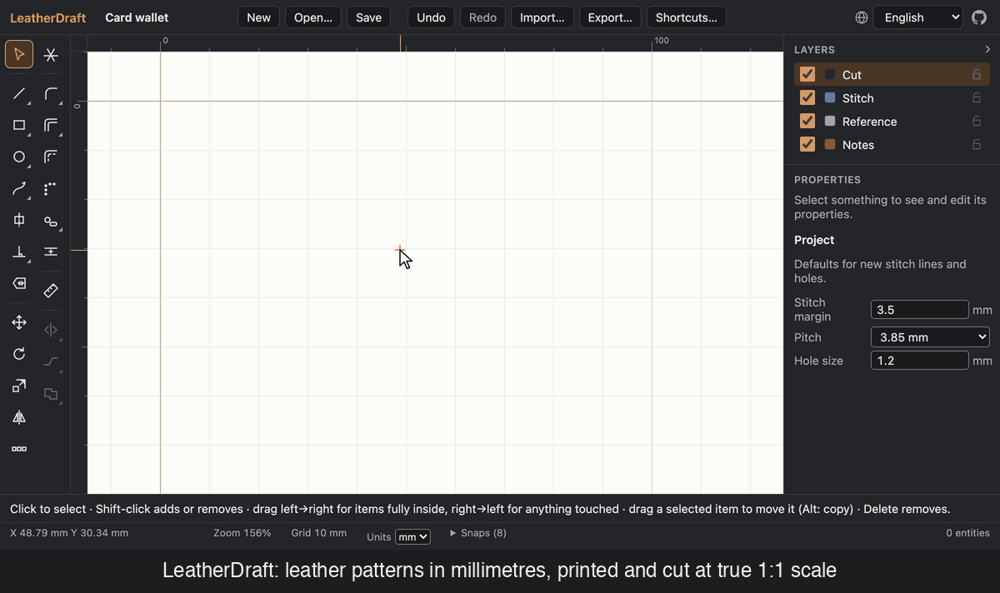

# LeatherDraft

**English** · [简体中文](README.zh-CN.md) · [繁體中文](README.zh-TW.md) · [Deutsch](README.de.md) · [Français](README.fr.md) · [Español](README.es.md) · [Italiano](README.it.md) · [Português](README.pt.md) · [日本語](README.ja.md) · [한국어](README.ko.md)

A browser-based 2D CAD tool for drafting **leather patterns in millimetres** and printing or cutting them at **true 1:1 scale**.

It runs entirely in your browser: no account, no server, and your files never leave your device. It installs as an app and works offline, and there is also a desktop app for Windows, macOS and Linux.



> **Status: pre-1.0.** The v1 drafting, leather and export features are implemented and tested. Still open before release: a physical print-accuracy check on real printers, compatibility checks in Inkscape, Illustrator and LightBurn, and a few smaller items (see [`docs/TASKS.md`](docs/TASKS.md)).

## Download

Desktop installers are on the **[Releases page](https://github.com/biuZam/webCAD/releases/latest)**:

- Windows: `LeatherDraft_<version>_x64-setup.exe`
- macOS (Apple Silicon and Intel): `LeatherDraft_<version>_universal.dmg`

The installers are not code-signed yet. On Windows, click **More info → Run anyway** in SmartScreen; on macOS, right-click the app and choose **Open** the first time. Linux: build from source (see [Desktop app](#desktop-app-tauri)).

## User guide

Step-by-step instructions for every tool, printing at true size, shortcuts and a worked example:

- [English](docs/USER_GUIDE.md)
- [简体中文](docs/USER_GUIDE.zh-CN.md)
- [繁體中文](docs/USER_GUIDE.zh-TW.md)
- [Deutsch](docs/USER_GUIDE.de.md)
- [Français](docs/USER_GUIDE.fr.md)
- [Español](docs/USER_GUIDE.es.md)
- [Italiano](docs/USER_GUIDE.it.md)
- [Português](docs/USER_GUIDE.pt.md)
- [日本語](docs/USER_GUIDE.ja.md)
- [한국어](docs/USER_GUIDE.ko.md)

## What it does

**Drafting**

- Lines (each segment its own object, as in CAD) and polylines, rectangles and squares (with corner radius), circles (centre + radius, 3 points, ellipse), Bézier pen, 3-point arcs
- Centre lines (usable as mirror axes) and perpendicular lines
- Labels: text (piece name, "cut 2"…) and grain arrows, on the notes layer
- Move, rotate, scale and mirror (each optionally as a copy), flip in place; linear and circular arrays
- Offset, fillet and chamfer; parallel lines; trim, extend and split; join paths; union and difference of shapes
- Edit points and Bézier handles directly; switch points between smooth and corner; add and delete points; drag selected shapes to move them
- Object snapping: endpoint, midpoint, centre, quadrant, intersection, perpendicular, tangent, nearest, grid; polar and object tracking
- Constraints: parallel, perpendicular, tangent, coincident, distance and radius, solved so the first object stays put and the second moves
- Exact values: type coordinates, lengths, angles and radii while drawing; edit numbers in the properties panel
- Layers (cut, stitch, reference, notes) with visibility, lock and colour; mm, cm or inch display

**Leather-specific**

- **Stitch lines** at a set margin from an outline, linked to it: edit the outline and the stitch line follows
- **Stitch holes** at chisel pitches (2.7, 3.38, 3.85, 4.0, 5.0 mm or custom), round or slanted slit. With "hole on every corner", spacing is evened out per edge so a hole lands exactly on each corner, the way you'd walk a chisel.
- Holes follow their stitch line, which follows its outline, all in one undo step
- **Hole count per edge**, and a check that two edges to be sewn together have the same count (Measure → Hole count)
- **Punch holes and slots** for rivets, snaps and buckles, with common punch diameters
- **Notches**: single or double alignment marks on any edge, as snips or V notches

**Output**

- **SVG** at 1:1 (1 unit = 1 mm), one layer per group, with an option to turn curves into short straight lines for laser software
- **PDF** for home printers: tiled on A4, Letter or A3 with overlap, crop marks and sheet labels, plus an assembly page with a **50 mm calibration square**. Or a single page sized to the pattern, for large-format printers.
- **DXF** (mm) for laser and CNC software, and a **PNG** picture for sharing
- Optional **watermark** text on exports (repeated on every PDF page)
- **Import SVG or DXF** at true size onto the reference layer, to trace an existing pattern
- Save and open `.json` project files. Work is autosaved in the browser and restored on reload.

### Printing at true size

Print the PDF at **100 % / "Actual size"**, never "Fit to page", then measure the 50 mm square on the first page. If it isn't 50 mm, check your printer's scaling settings.

## Keyboard shortcuts

| Key | Tool | Key | Tool |
| --- | --- | --- | --- |
| V | Select (and edit points) | M | Move |
| L | Line / polyline | O | Rotate |
| R | Rectangle | S | Scale |
| C | Circle / 3-point / ellipse | I | Mirror |
| P | Pen (curves) | Shift+H / Shift+V | Flip horizontal / vertical |
| A | Arc (3 points) | E | Offset |
| X | Centre line | F | Fillet |
| T | Perpendicular | B | Chamfer |
| D | Measure | K | Stitch line |
| N | Label / grain arrow | H | Stitch holes |
| G | Parallel line | W | Trim / extend / split |
| U | Punch hole / slot | Y | Seam allowance (per edge) |
| Q | Array (linear / circular) | J | Notch |
| Shift+J | Join paths | Shift+U / Shift+D | Union / difference |
| Z | Constraint | Shift+X | Explode into segments |

Similar tools share a palette slot, as in Photoshop: **right-click** a slot with a corner triangle (or long-press, or press → on it) to pick another — line / polyline, rectangle / square, circle / 3-point circle / ellipse, pen / arc, perpendicular / parallel, fillet / chamfer, offset / seam allowance, punch / notch, flip horizontal / vertical, join / explode, union / difference. The side panel folds away with the arrow at its top.

Every tool and action key can be changed under **Shortcuts…** in the toolbar (kept per browser).

While drawing: **start typing a number** to enter it in the input bar, **Tab** moves between fields, **Enter** applies, **Esc** cancels, **Backspace** removes the last point, **Shift** locks angles to 15° steps. **Space-drag** or middle-drag pans, the wheel zooms. **⌘/Ctrl+Z / ⇧⌘Z** undo/redo, **⌘/Ctrl+S** save, **⌘/Ctrl+O** open, **⌘/Ctrl+A** select all.

## Development

Requires **Node ≥ 20.19** and **pnpm 10** (`corepack enable` picks up the version from `package.json`).

```bash
pnpm install
pnpm dev                     # http://localhost:5173
```

Useful URLs in development:

- `?fixture=acceptance`: the PRD acceptance drawing (100 mm square, 50 mm circle, 3.85 mm stitch holes)
- `?fixture=perf`: 2,000 entities for performance checks

Fixture sessions are never autosaved, so they can't overwrite your own work.

| Command | What it does |
| --- | --- |
| `pnpm test` | Unit and component tests (Vitest); `pnpm test <file>` or `pnpm test -t "<name>"` for one |
| `pnpm check` | Typecheck, lint, tests and translation report |
| `pnpm verify` | Everything CI runs: the above plus formatting, production build and bundle budget |
| `pnpm build` / `pnpm preview` | Production build (with service worker) and a local preview of it |
| `pnpm i18n:check` | Keys missing from non-English locales |
| `pnpm bundle:check` | Initial download must stay under 600 KB gzipped |
| `BENCH=1 pnpm test perf.bench` | Performance probe on 2,000 entities |
| `pnpm exec tsx scripts/demo/record-demo.ts` + `python3 scripts/demo/make-gif.py` | Re-record `docs/media/demo.gif` (dev server on :5199 first; see the script header) |

If package installs are slow where you are, try a registry mirror, e.g. `pnpm install --registry=https://registry.npmmirror.com`.

### Desktop app (Tauri)

`src-tauri/` wraps the same Vite build in a native window (Windows, macOS, Linux). It needs a Rust toolchain plus the platform's build tools ([Tauri prerequisites](https://v2.tauri.app/start/prerequisites/)).

```bash
pnpm desktop:dev             # native window on the Vite dev server (hot reload)
pnpm desktop:build           # installer for this OS in src-tauri/target/release/bundle/
pnpm tauri build --bundles app   # macOS: just LeatherDraft.app, no .dmg
```

Differences from the web app: Save, Open and Export use native file dialogs (Save keeps writing to the same file until you quit), and there is no service worker; the app updates by installing a new version. Autosave works as in the browser. Tauri can't cross-compile, so Windows installers come from CI: run the **Desktop** workflow (`.github/workflows/desktop.yml`) or push a `desktop-v*` tag; it builds a Windows `.exe` (NSIS) and a universal macOS `.dmg` as workflow artifacts. App icons in `src-tauri/icons` are generated from `public/icon.svg` with `pnpm tauri icon public/icon.svg -o src-tauri/icons`.

### Tech stack

React 19 + TypeScript + Vite · [Paper.js](http://paperjs.org) for geometry and rendering · Zustand + Immer (document store, undo/redo as patches) · [paperjs-offset](https://github.com/glenzli/paperjs-offset) with a Clipper fallback for offsets · jsPDF + svg2pdf.js for PDF (loaded on demand) · i18next · vite-plugin-pwa · Vitest.

### How it fits together

- **The drawing is plain JSON in millimetres**, held in a store. Every change is a command, which gives unlimited undo and simple save files.
- **Paper.js** draws the screen and does the geometry maths, but doesn't own the data.
- **Linked entities are regenerated inside the same command** that changes their source, so stitch lines and holes are never out of date.
- **PDF is rendered from the same SVG** the app exports, so screen, SVG and print can't drift apart.

More detail:

- [`docs/ARCHITECTURE.md`](docs/ARCHITECTURE.md): design decisions, layers, data model, performance and accessibility notes
- [`docs/USER_GUIDE.md`](docs/USER_GUIDE.md) / [`docs/USER_GUIDE.zh-CN.md`](docs/USER_GUIDE.zh-CN.md): user guide in English and Simplified Chinese
- [`docs/MCP.md`](docs/MCP.md): headless MCP server, so AI clients can draw, edit, stitch and export patterns
- [`docs/TASKS.md`](docs/TASKS.md): task list and progress by milestone
- [`PRD — Leather Pattern CAD (Web).md`](<PRD — Leather Pattern CAD (Web).md>): product requirements
- [`CLAUDE.md`](CLAUDE.md): conventions for working on the code

### Quality bars

- **Accuracy.** Offsets stay within 0.02 mm of the requested distance, and fillet arcs within 0.001 mm of a true circle. PDF scale is verified in tests by reading the PDF's drawing commands back as page millimetres.
- **Performance.** 2,000 entities (17,600 stitch holes) redraw in about 12 ms.
- **Accessibility.** WCAG 2.2 AA colour contrast is enforced in CI for light and dark themes, and an axe-core audit reports no violations.

## Languages

The interface is available in English, 简体中文, 繁體中文, Deutsch, Français, Español, Italiano, Português, 日本語 and 한국어; switch it with the globe icon in the toolbar. PDF page text follows the interface language, and Chinese text in PDFs (page text, labels, names) is printed with an embedded Noto Sans SC font.

The user guide is available in every interface language under `docs/` (for example [English](docs/USER_GUIDE.md), [简体中文](docs/USER_GUIDE.zh-CN.md), [繁體中文](docs/USER_GUIDE.zh-TW.md), [Deutsch](docs/USER_GUIDE.de.md), [Français](docs/USER_GUIDE.fr.md), [Español](docs/USER_GUIDE.es.md), [Italiano](docs/USER_GUIDE.it.md), [Português](docs/USER_GUIDE.pt.md), [日本語](docs/USER_GUIDE.ja.md), [한국어](docs/USER_GUIDE.ko.md)).

This README is also available in these languages: [简体中文](README.zh-CN.md) · [繁體中文](README.zh-TW.md) · [Deutsch](README.de.md) · [Français](README.fr.md) · [Español](README.es.md) · [Italiano](README.it.md) · [Português](README.pt.md) · [日本語](README.ja.md) · [한국어](README.ko.md).

## License

LeatherDraft is **source-available** under the [PolyForm Noncommercial License 1.0.0](LICENSE):

- **Free** for personal, hobby, study and research use, and for schools, charities and other noncommercial organisations. You may change the code and share your changes for noncommercial purposes.
- **Your patterns and products are yours.** Drawings, exported files and the leather goods you make from them are not restricted; you may sell them.
- **Commercial use of the software itself** (selling it or a modified version, offering it as a service, building it into a commercial product) needs a commercial license: email [igamitec@gmail.com](mailto:igamitec@gmail.com). Modified versions can't be used commercially. See [COMMERCIAL.md](COMMERCIAL.md).
- Contributions are welcome; contributors sign a [CLA](CLA.md) once. See [CONTRIBUTING.md](CONTRIBUTING.md).

"LeatherDraft" and its logo are not covered by the license. Versions up to commit `ca93653` / `7db180a` (10 October 2026) were released under Apache-2.0.

许可：PolyForm 非商业许可证 1.0.0。个人和非商业用途免费；用它画出的版型和制作的产品归你所有，可以出售；将软件本身用于商业用途需获得授权，请联系 [igamitec@gmail.com](mailto:igamitec@gmail.com)，详见 [COMMERCIAL.md](COMMERCIAL.md)。
